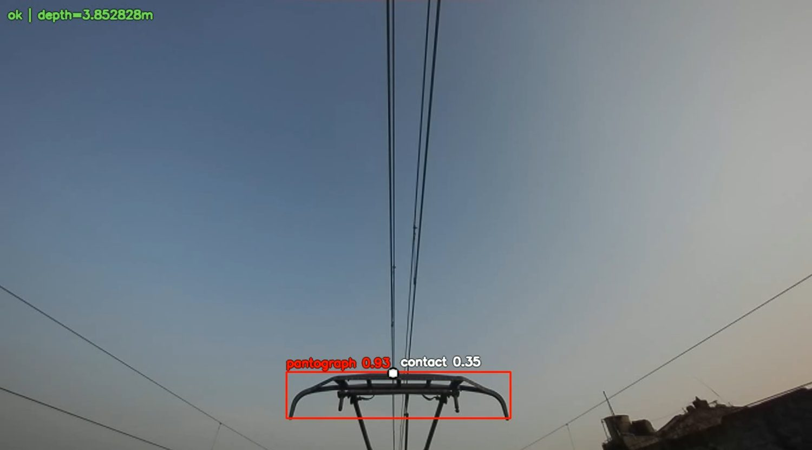
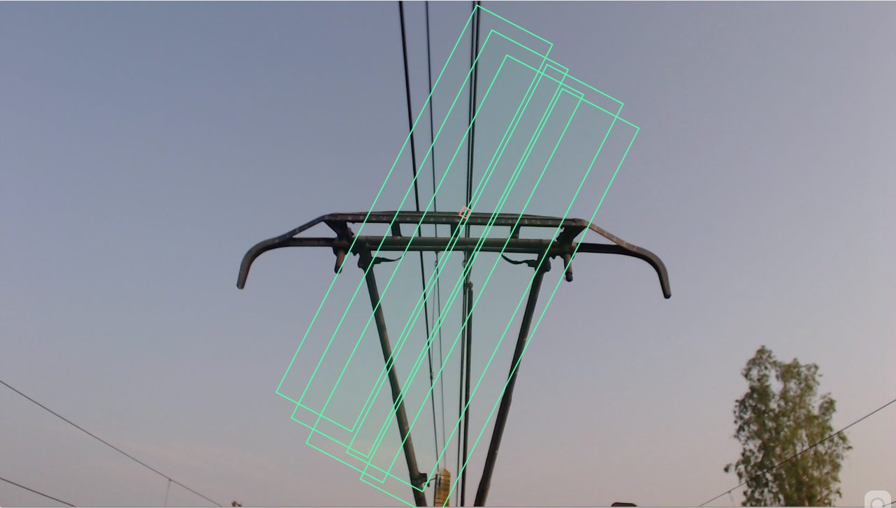
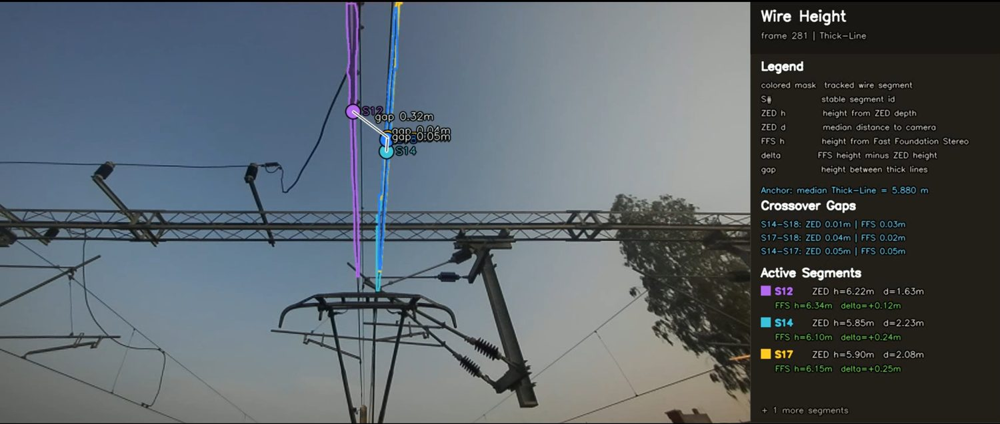
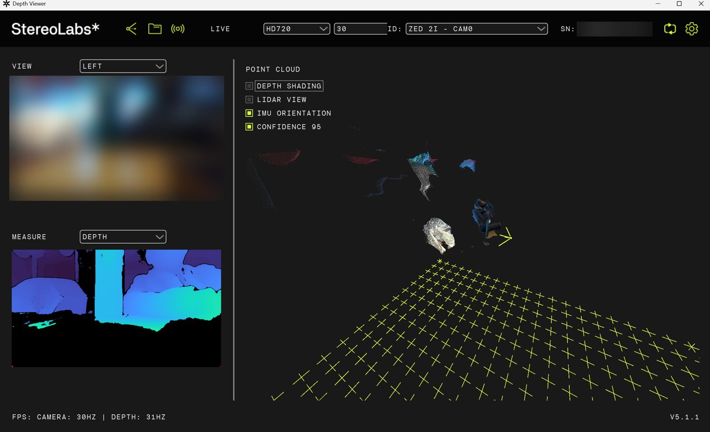
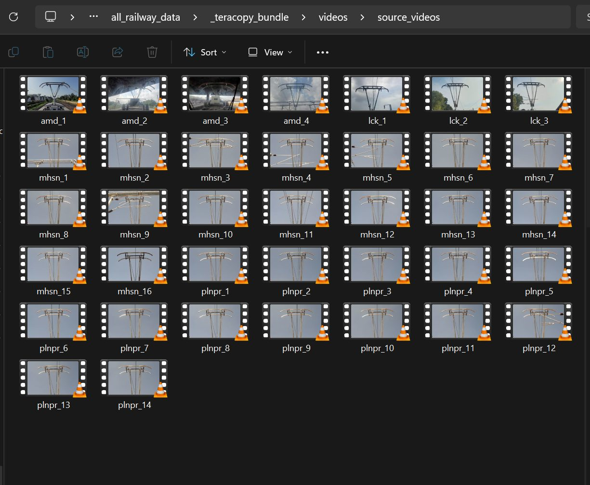
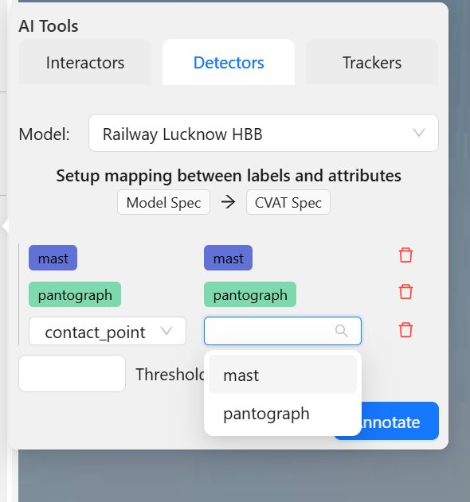
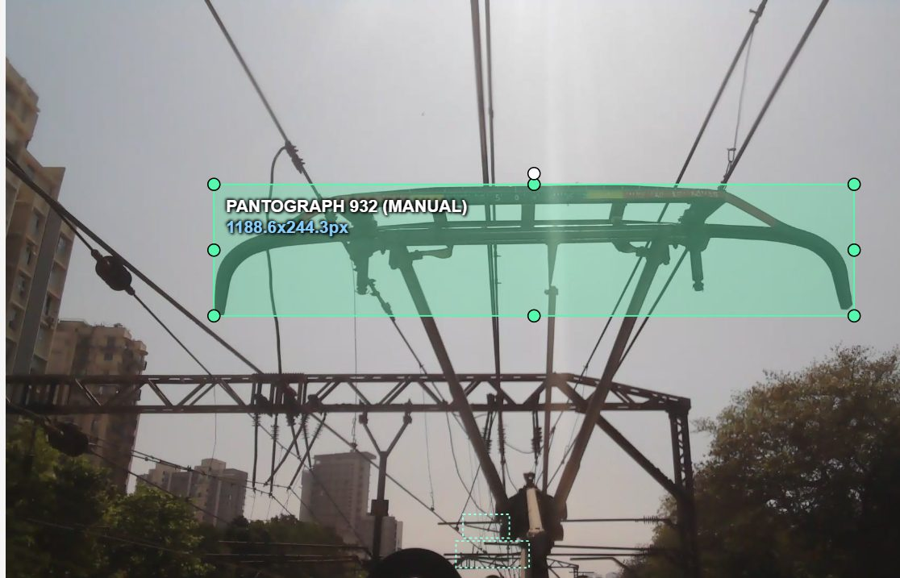
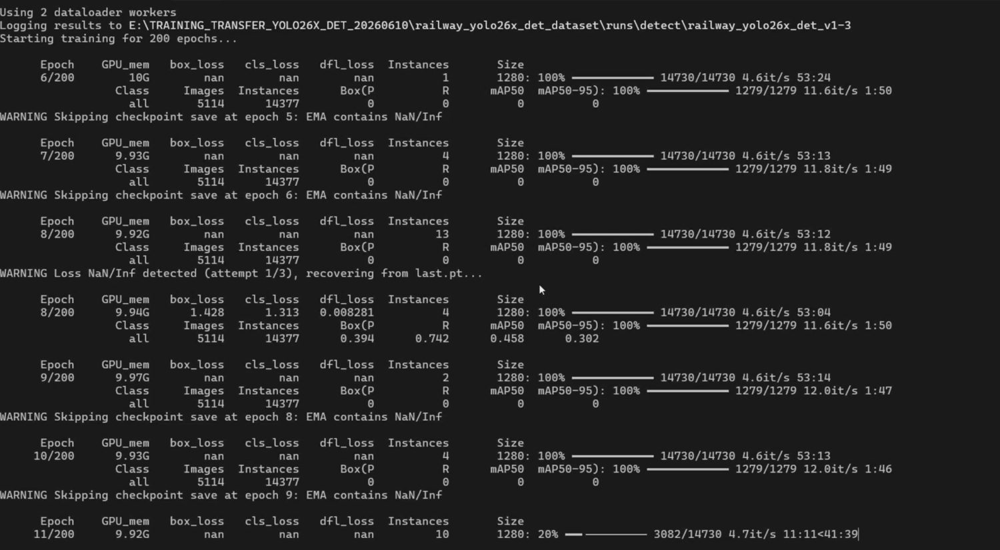

# Railway Overhead-Line Detection

Detecting the **pantograph, masts, arms and contact points** on railway overhead electrification from cabin-camera video, so that heights can be measured from a detection.

> **This repository documents the work. It contains no source code and no dataset.** The code is proprietary and the 23,551-frame dataset (8.13 GB) is private. What is here is the method, the timeline, screenshots and the results, including what is still imperfect.

**Links:** [Animated project story](https://satyamsaxena1.github.io/railway/) &middot; [Kaggle write-up with sample frames](https://www.kaggle.com/datasets/satyamsaxena12/railway-overhead-line-showcase) &middot; [Portfolio](https://satyamsaxena1.github.io/)

## At a glance

| | |
|---|---|
| Frames labelled and reviewed | 23,551 from five Indian routes (Lucknow, Ahmedabad, Mehsana, Palanpur, Mumbai) |
| Labelled boxes | 133,245 across `contact_point`, `mast`, `pantograph`, `arm` |
| Review | 31 CVAT tasks, 119,972 shapes passed through review |
| Models | YOLO26x and RF-DETR Large |
| Best validation mAP@50:95 | YOLO26x 0.698 &middot; RF-DETR 0.679 (different validation sets, not a ranking) |

## The goal, and why plain boxes

A camera in the cab looks up at the pantograph and the overhead line. If a model finds those elements reliably, their height can be measured from the detection. For that measurement the top edge of a box has to stay parallel to the bottom of the frame, so I use plain axis-aligned boxes. I tried rotated boxes and dropped them: far more labelling effort for no payoff in the measurement.

## Timeline

| When | What happened |
|---|---|
| Nov - Dec 2025 | **Proof of concept** with a public Roboflow contact-point dataset (none of its images are in my dataset). First plan: a custom attention network with depth input. |
| Dec 2025 - Apr 2026 | **Depth exploration**: ZED 2i stereo camera, Isaac Sim synthetic scenes, Depth Anything. A real-time detection and measurement system was built and run on trains in Lucknow (not published here). |
| May 2026 | **Wire height from depth**: ZED depth compared with Fast-FoundationStereo, with a detector finding the wires. Rotated-box experiments, then dropped. |
| May - Jun 2026 | **Labelling campaign**: a small pretrained detector pre-annotates, tracking carries boxes between frames, and I review every frame in CVAT. |
| 10 - 23 Jun 2026 | **YOLO26x** trained on one RTX 4070: about 57 minutes per epoch, roughly 8 days for 200 epochs. Early epochs hit NaN losses and were recovered and resumed. |
| 29 - 30 Jun 2026 | **RF-DETR Large** trained on a rented H100 (80 GB) in about 19 hours. |

| Wire height from depth | ZED depth viewer (camera view blurred) |
|---|---|
|  |  |

## How the labels were made

1. **Film** cabin-camera footage from five routes; cut into short segments and extract frames.
2. **Pre-annotate** with a small pretrained detector.
3. **Track** boxes between frames from manual keyframes.
4. **Review** every frame in CVAT: fix positions, classes and missing objects.

CVAT records how each shape entered the tool: 107,797 imported, 13,273 tracked, 8,136 model-assisted, 2,719 semi-automatic, 1,320 drawn by hand. That is how boxes arrived, not how many I edited.

| Raw source videos | Model-assisted pre-annotation | Reviewed box |
|---|---|---|
|  |  |  |

## Results

Per-class validation AP@50:95:

| Class | YOLO26x | RF-DETR Large |
|---|---:|---:|
| `pantograph` | 0.902 | 0.923 |
| `mast` | 0.790 | 0.704 |
| `arm` | 0.714 | 0.686 |
| `contact_point` | 0.386 | 0.389 |
| **Overall** | **0.698** | **0.679** |
| Validation images | 5,114 | 3,941 |

**Read this carefully.** The two models were validated on different image sets, with different metric implementations and input sizes (1280 vs 1120 px), so this is not a head-to-head ranking. What holds for both: the pantograph is detected well and the contact point is the weak class, which points at the data (tiny boxes, some frames with a missing pantograph) more than at the model choice.

## What is still imperfect

- About 5% of train and 6% of validation frames have a contact point but no pantograph box, mostly in the tracked and model-assisted video sets.
- YOLO and RF-DETR were scored on different validation sets, and the RF-DETR validation and test splits share video segments.
- Neighbouring video frames are near-duplicates, so the number of distinct scenes is far smaller than the frame count.
- One annotator, five routes: no inter-annotator agreement, and a limited domain.

---

&copy; 2026 Satyam Saxena. All rights reserved. This repository contains documentation and screenshots only; it contains no source code and no dataset.
