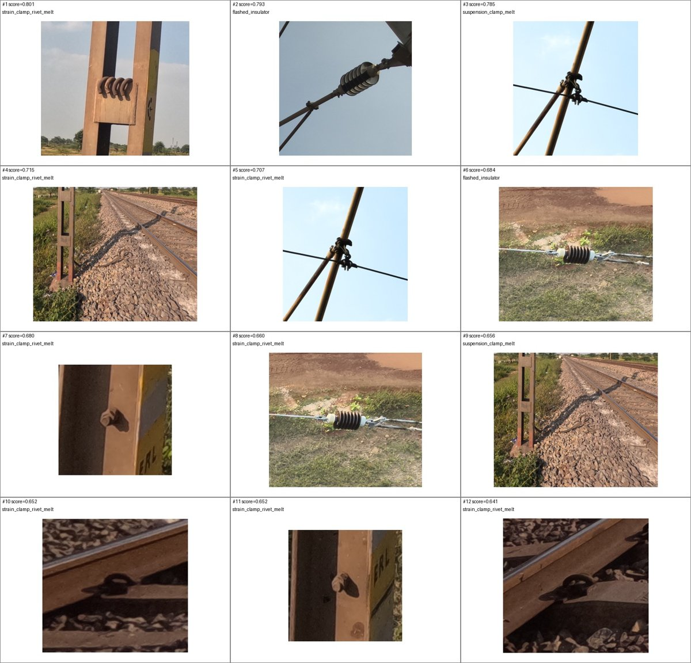
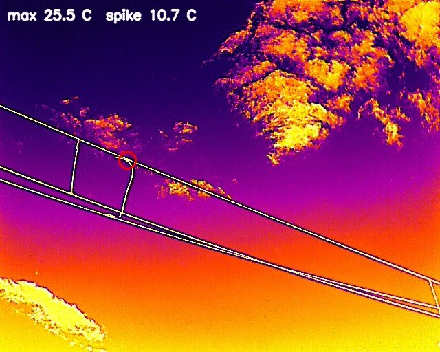
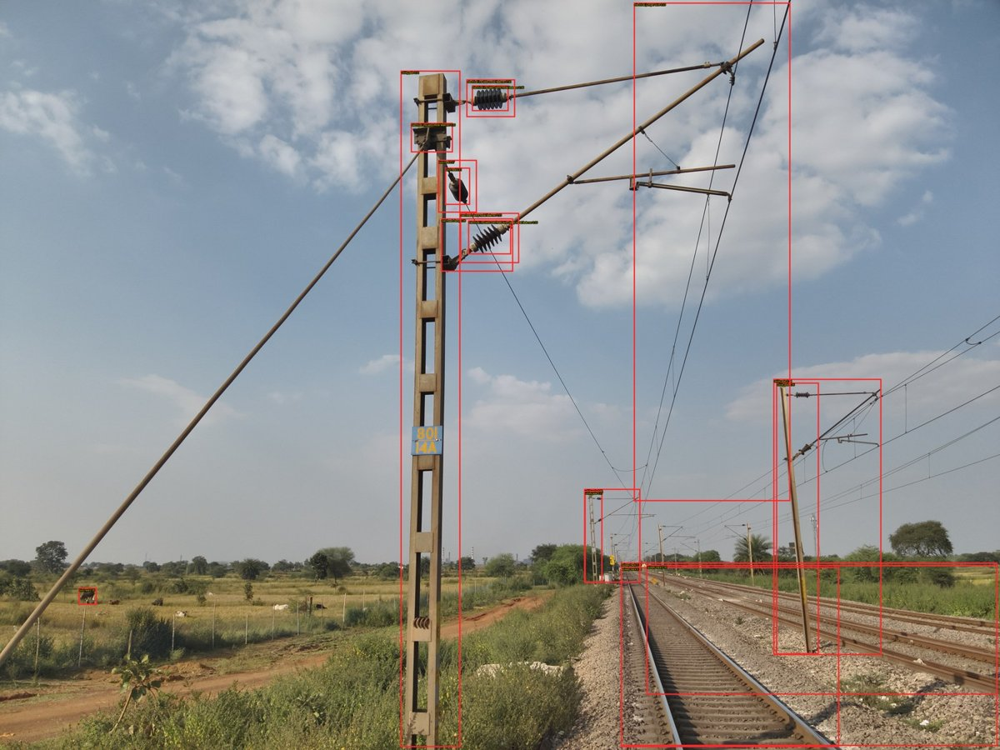

# Drone OHE inspection: SAM3, thermal and component-review study

This page records a separate drone-based overhead-electrification inspection study. It complements the cabin-camera pantograph project in this repository; it does not replace its results.

> **Status:** research and triage only. No inspected defect is certified. The private source images, Word inspection report, radiometric SDK archive, and full-resolution masks are deliberately excluded.

## Dataset

| Item | Count |
|---|---:|
| Railway locations | 40 |
| Images | 629 |
| Visible `_V.JPG` frames | 344 |
| DJI Mavic 3 Thermal `_T.JPG` R-JPEG frames | 285 |

The imagery is predominantly wide-angle. Some frames show track, ground, sky, or a full mast rather than a close component; small fasteners, hairline cracks, early flash damage, and subtle melting cannot be reliably assessed in those frames.

## What the image analysis found

| Method | Scope | Result | Interpretation |
|---|---|---|---|
| SAM3 defect-text prompting | 44 candidates at score >= 0.5 | 44 coherent object masks; 10/44 plausible component matches; **0/44 visually confirmed prompted defects** | Good mask tool after a component is known; prompt score is not defect evidence |
| Grounding DINO components | 40 representative visible frames; 432 proposals | 9/13 strongest insulator-result images contained a correctly boxed insulator; 4 were false scene matches | Better component proposer than direct defect prompting; not a defect verifier |
| Full-frame PatchCore-style proxy | 40 paired locations | Highest ranks came from viewpoint, ballast, vegetation, track geometry and shadows | Do not use full-frame anomaly scores |
| DJI Thermal SDK v1.9 | all 285 M3T R-JPEGs | zero decode failures; 8/12 strongest isolated spikes land on OHE dropper/wire junctions | engineering-review candidates, not confirmed thermal faults |

## Representative evidence

### SAM3 audit: accurate mask boundaries do not establish defect state

The complete manual audit found normal-looking insulators, railway fastening clips, pole bolts/cleats and ground cable loops among the false candidates. This is why proposed labels such as *melted rivet* or *flashed insulator* must be reviewed.

### Radiometric junction candidate

This candidate reached 25.5 C with a 10.7 C isolated spike above the frame p99.9 statistic. The position is a real junction, but emissivity, angle, reflected temperature, solar loading and mixed pixels can produce a similar result.

### Component proposals

The useful outcome is a component crop, not a zero-shot defect label. The boxes shown include correct insulator proposals and incorrect scene-level proposals.

## Confirmed, unconfirmed and not assessable

- **Confirmed in the images:** ordinary insulators, clamps/fittings, droppers, wire junctions, pole bolts/cleats and ground cable loops are visible.
- **Review candidates:** eight radiometric junction spikes require an OHE engineer to compare with neighbouring/peer junctions under similar load.
- **Not visually confirmed in the reviewed subset:** suspension-clamp melting, strain-clamp/rivet melting, bent operating rod, broken/flashed insulator, bird nest, missing/loose fastener, or damaged G-jumper.
- **Generally not assessable at this capture scale:** tiny rivets/nuts/washers, hairline cracks, early surface flash, subtle deformation, and internal electrical condition.

## Recommended next phase

1. Record close, repeatable multi-view imagery for each component and log distance, emissivity, ambient/reflected temperature and electrical load.
2. Label component crops as `normal`, `defect visible`, `not assessable`, and `false proposal`; include a polygon/mask and defect subtype when known.
3. Train a component detector for mast, insulator, clamp, fastener, jumper connection, dropper and isolator linkage.
4. Use SAM3 only to refine accepted component boxes to masks.
5. Train a component-specific supervised defect classifier when verified defects exist; otherwise use anomaly detection on aligned normal crops.
6. Compare thermal ROI temperature with adjacent conductors and peer junctions, rather than using the hottest full-frame pixel.
7. Evaluate on a location-separated, date-separated engineer-labelled holdout set with per-class precision/recall, AP, false alerts per 100 assets, and thermal alert confirmation rate.

## Current metrics and limitations

There is **no defensible defect-detection precision/recall yet** because the inspected data lacks confirmed positive defect labels. The numerical results above are proposal-audit and candidate-yield metrics, not defect accuracy. Any alert remains an aid for inspection and must be accepted by a qualified railway engineer.
